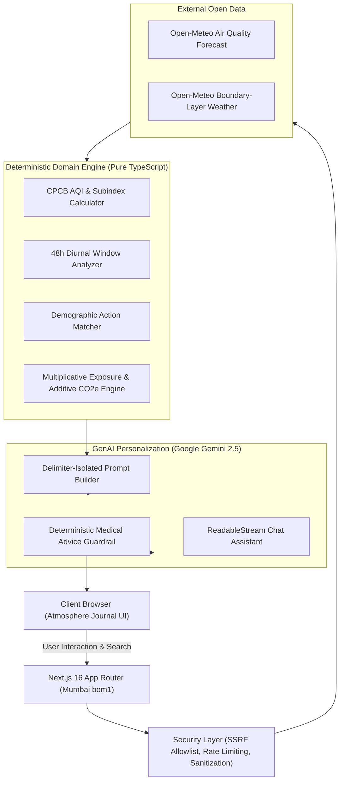

# SaafSaans (साफ़ साँस) — Winter Smog Lifestyle Assistant

> **Empowering Indo-Gangetic households with hyper-local atmospheric forecasts, deterministic exposure mitigation, sustainable low-carbon swaps, and empathetic GenAI guidance during peak winter air emergencies.**

[](https://github.com/saaf-saans/saaf-saans)
[](docs/ARCHITECTURE.md)
[](tests/unit/a11y/axe.test.tsx)
[](https://nextjs.org)
[](tsconfig.json)
[](LICENSE)

---

## 1. The Pitch

During winter in Northern India and the Indo-Gangetic Plain, thermal inversions trap toxic particulates ($PM_{2.5} > 300\ \mu\text{g/m}^3$, reaching 20× to 30× WHO limits), turning everyday activities into health hazards. Standard weather apps simply display grim AQI digits without telling families what to do, while ungrounded chatbots hallucinate dangerous home remedies or impossible exposure numbers. **SaafSaans (साफ़ साँस)** bridges this divide through an editorial "Atmosphere Journal" experience: combining open meteorological satellite dispersion data with a pure, deterministic exposure reduction engine and Google Gemini 2.5 Flash. SaafSaans provides actionable, time-blocked daily routines, domestic filtration hacks, sustainable lifestyle swaps, and grounded follow-up Q&A tailored to each household's demographics and budget—all without a single hallucinated calculation or medical risk.

---

## 2. Requirements & Source Alignment Table

| Requirement / Problem Area          | Solution Feature                                                                                             | Primary Implementation Files                                                                                                                                                                                                                                                      |
| ----------------------------------- | ------------------------------------------------------------------------------------------------------------ | --------------------------------------------------------------------------------------------------------------------------------------------------------------------------------------------------------------------------------------------------------------------------------- |
| **Real-time Air Quality & Verdict** | Section 01 Air now: animated skyline haze, CPCB gauge, plain-language health verdict                         | [src/features/hero/HeroSection.tsx](file:///c:/projects/6/src/features/hero/HeroSection.tsx), [SkylineHaze.tsx](file:///c:/projects/6/src/features/hero/SkylineHaze.tsx), [AqiDial.tsx](file:///c:/projects/6/src/features/hero/AqiDial.tsx)                                      |
| **48-Hour Forecast & Windowing**    | Section 02 Next 48 hours: custom SVG timeline chart, draggable scrubber, optimal/avoid badges                | [src/features/timeline/TimelineSection.tsx](file:///c:/projects/6/src/features/timeline/TimelineSection.tsx), [TimelineAreaChart.tsx](file:///c:/projects/6/src/features/timeline/TimelineAreaChart.tsx), [bestWindow.ts](file:///c:/projects/6/src/domain/planner/bestWindow.ts) |
| **Demographic Household Profiling** | Section 03 Your household: 1-click presets ("Family with kids", "Hostel student") & custom adjustments       | [src/features/profile/ProfileSection.tsx](file:///c:/projects/6/src/features/profile/ProfileSection.tsx), [ProfilePresetsBar.tsx](file:///c:/projects/6/src/features/profile/ProfilePresetsBar.tsx), [presets.ts](file:///c:/projects/6/src/domain/profile/presets.ts)            |
| **4-Tab Actionable Plan**           | Section 04 Your plan: Routine, Home air, Swaps, Community playbooks with multi-language support (EN, HI, BN) | [src/features/plan/PlanSection.tsx](file:///c:/projects/6/src/features/plan/PlanSection.tsx), [ActionItemCard.tsx](file:///c:/projects/6/src/features/plan/ActionItemCard.tsx), [translations.ts](file:///c:/projects/6/src/features/plan/translations.ts)                        |
| **Grounded Follow-up Q&A**          | Plan-grounded streaming chat drawer with chip suggestions, deterministic medical guardrail                   | [src/app/api/chat/route.ts](file:///c:/projects/6/src/app/api/chat/route.ts), [PlanFollowUpChat.tsx](file:///c:/projects/6/src/features/chat/PlanFollowUpChat.tsx), [chatGuardrail.ts](file:///c:/projects/6/src/domain/ai/chatGuardrail.ts)                                      |
| **Interactive Impact Modeling**     | Section 05 Your impact: interactive action checklist, live animated exposure & carbon meter                  | [src/features/impact/ImpactSection.tsx](file:///c:/projects/6/src/features/impact/ImpactSection.tsx), [model.ts](file:///c:/projects/6/src/domain/impact/model.ts), [modelDrawer.tsx](file:///c:/projects/6/src/features/impact/ModelDrawer.tsx)                                  |
| **Printable Emergency Plan**        | One-page printable refrigerator cheat-sheet with emergency contact fill-ins                                  | [src/features/print/PrintFamilyPlan.tsx](file:///c:/projects/6/src/features/print/PrintFamilyPlan.tsx)                                                                                                                                                                            |
| **Security & SSRF Defense**         | Outbound host allowlist, in-memory sliding window rate limiters, input sanitization                          | [src/server/security/fetchAllowlist.ts](file:///c:/projects/6/src/server/security/fetchAllowlist.ts), [rateLimiter.ts](file:///c:/projects/6/src/server/security/rateLimiter.ts), [sanitize.ts](file:///c:/projects/6/src/server/security/sanitize.ts)                            |
| **Accessibility Compliance**        | Automated axe-core unit testing, keyboard shortcuts ('T', '/', '?'), prefers-reduced-motion                  | [tests/unit/a11y/axe.test.tsx](file:///c:/projects/6/tests/unit/a11y/axe.test.tsx), [KeyboardShortcuts.tsx](file:///c:/projects/6/src/components/KeyboardShortcuts.tsx), [journey.spec.ts](file:///c:/projects/6/tests/e2e/journey.spec.ts)                                       |

---

## 3. System Architecture



---

## 4. Where GenAI is Used (and Why)

SaafSaans enforces a deliberate architectural boundary between **deterministic computation** and **generative synthesis**:

```
┌────────────────────────────────────────┐   ┌────────────────────────────────────────┐
│     DETERMINISTIC ENGINE (Pure TS)     │   │      GENERATIVE AI (Gemini 2.5)        │
│                                        │   │                                        │
│ • CPCB Subindex Breakpoints            │   │ • Empathetic Daily Narrative Synthesis │
│ • 48-Hour Optimal Windows              │   │ • Household-Specific Action Rationales │
│ • Multiplicative Inhalation Reduction  │   │ • Hindi & Bengali Context Localization │
│ • Additive Carbon Accounting           │   │ • Grounded Follow-up Streaming Q&A     │
│ • Hard Medical Keyword Interception    │   │ • Zero Numerical Hallucinations Allowed│
└────────────────────────────────────────┘   └────────────────────────────────────────┘
```

### 4.1 Strict Prompt Engineering & Delimiter Isolation

- **Prompts** use explicit `<<<INSTRUCTIONS>>>`, `<<<DATA>>>`, and `<<<USER_QUESTION>>>` delimiters to neutralize jailbreak attempts and system prompt overrides.
- **Negative Constraint Directives:** The system prompt explicitly enforces `ZERO NUMBERS: Do not cite any numerical quantities, percentages, or concentrations` in plan generation. All numbers displayed in the UI originate directly from the deterministic catalog.
- **Structured JSON Schema:** Gemini responses are forced into typed schemas validated by Zod (`StructuredAiResponse`). Any parsing error instantly falls back to rule-based qualitative text.

### 4.2 Deterministic Medical Advice Guardrail

- Medical inquiries (e.g., asking for asthma inhaler dosages, paracetamol, or diagnostic interpretations) are intercepted by a deterministic regex engine (`src/domain/ai/chatGuardrail.ts`) **before** invoking the LLM.
- The user is immediately provided with a clinical refusal directing them to emergency medical care, preventing dangerous LLM-generated health advice.

---

## 5. Data & Model Honesty

1. **Modelled Estimates vs. Ground Monitors:** Open-Meteo forecasts utilize global and regional atmospheric dispersion models (ECMWF, CAMS) assimilated with satellite observations. While ground monitors (CPCB/SAFAR CAAQMS stations) measure point source air quality at street level, satellite-derived models provide continuous spatial coverage across unmonitored residential colonies. SaafSaans explicitly displays this distinction in Section 01 and provides direct links to the official [CPCB National Air Quality Index portal](https://app.cpcbccr.com/AQI_India/).
2. **Transparent Scientific Evidence:** Every single action card in Section 04 and Section 05 includes a "Why this matters" expandable drawer citing the exact empirical literature or national guidelines (e.g., WHO Guidelines 2021, US EPA, CPCB, or marked explicitly as an `assumption`).

---

## 6. How Impact Numbers are Estimated

### Multiplicative Exposure Model ($PM_{2.5}$)

To avoid the mathematical fallacy of adding independent filtration efficiencies together ($50\% + 40\% + 30\% \ne 120\%$), SaafSaans computes residual exposure multiplicatively across selected actions $a_i \in A$:

$$R_{\text{raw}} = \left( 1 - \prod_{a_i \in A} (1 - r_i) \right) \times 100$$

To account for building cracks, clothing track-in, and imperfect mask seals, combined reductions are capped at an empirical physical ceiling of **85.0%**:

$$R = \min\left(85.0\%, R_{\text{raw}}\right)$$

### Additive Carbon Offsets ($CO_2e$)

Fuel and transport substitutions displace independent fossil fuel burning. Savings are therefore strictly additive:

$$\Delta CO_2e_{\text{week}} = \sum_{a_i \in A} \text{co2e}_{i,\text{week}} \quad [\text{kg } CO_2e/\text{week}]$$

$$\Delta CO_2e_{\text{year}} = \Delta CO_2e_{\text{week}} \times 52.14 \quad [\text{kg } CO_2e/\text{year}]$$

Full coefficients, confidence scores, and literature sources are cataloged in [docs/IMPACT_MODEL.md](file:///c:/projects/6/docs/IMPACT_MODEL.md).

---

## 7. Setup & Installation

### Prerequisites

- Node.js `22.x` (or `>= 20.x`)
- npm `10.x` or higher

### Installation Steps

```bash
# 1. Clone repository
git clone https://github.com/saaf-saans/saaf-saans.git
cd saaf-saans

# 2. Install dependencies (strictly locked versions)
npm install

# 3. Configure environment variables (optional for AI mode; defaults to rule-based)
cp .env.example .env.local
# Set GEMINI_API_KEY=your_key_here

# 4. Start local development server with Turbopack
npm run dev

# 5. Open browser
open http://localhost:3000
```

---

## 8. Test & Coverage Summary

The codebase enforces strict unit, integration, accessibility, and E2E coverage:

```bash
# Run unit tests
npm test

# Run test coverage audit (thresholds: Domain ≥ 95%, Overall ≥ 90%)
npm run test:coverage

# Run automated axe-core accessibility audits
npx vitest run tests/unit/a11y/axe.test.tsx

# Run Playwright end-to-end browser tests
npm run test:e2e

# Run production smoke test suite
npm run smoke

# Check repository file size budget (< 5 MB tracked)
npm run repo-size
```

---

## 9. Accessibility & Security

- **WCAG 2.1 AA Compliant:** Zero axe-core accessibility violations across all components, color modes, and interactive states.
- **Keyboard Navigation:**
  - `T`: Toggle between Light ("paper") and Night themes.
  - `/`: Focus location search combobox.
  - `?`: Open keyboard shortcuts cheat-sheet modal.
  - `Esc`: Close open dialogs or drawers.
  - `Left` / `Right` Arrow keys: Scrub 48-hour timeline area chart.
- **Motion Sensitivities:** Automatically disables particle simulations and smooth transitions when `prefers-reduced-motion` is detected.
- **Enterprise Security Headers:** Full `Content-Security-Policy`, `HSTS`, `X-Content-Type-Options: nosniff`, `X-Frame-Options: DENY`, and strict per-IP rate limiting.

---

## 10. Known Limitations & Future Work

1. **Ground Sensor Ingestion:** Future versions plan to ingest hyper-local data from low-cost sensor meshes (e.g., PurpleAir, OpenAQ) to supplement satellite dispersion forecasts.
2. **Indoor Sensor Integration:** Enable Bluetooth/Matter pairing with domestic air purifiers and PM2.5 monitors for real-time indoor feedback loops.
3. **Hyper-local RWA Aggregation:** Expand the Community tab into a shared building dashboard for society resident welfare associations.

---

## 11. Attributions & License

- **Data Attribution:** Meteorological dispersion and air quality forecast data provided courtesy of [Open-Meteo](https://open-meteo.com) under CC BY 4.0.
- **Standards:** Air Quality Index thresholds aligned with the [Central Pollution Control Board (CPCB)](https://cpcb.nic.in) National Air Quality Index.
- **License:** Released under the [MIT License](LICENSE).
