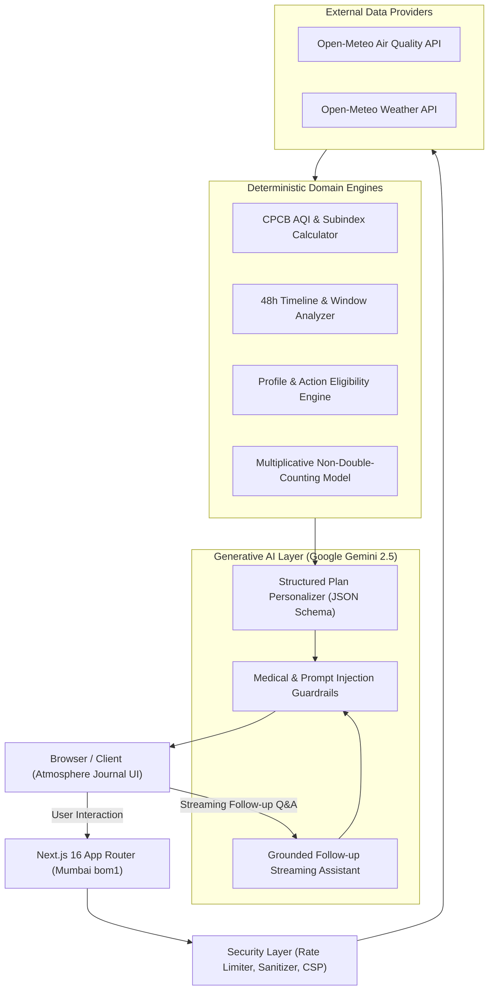
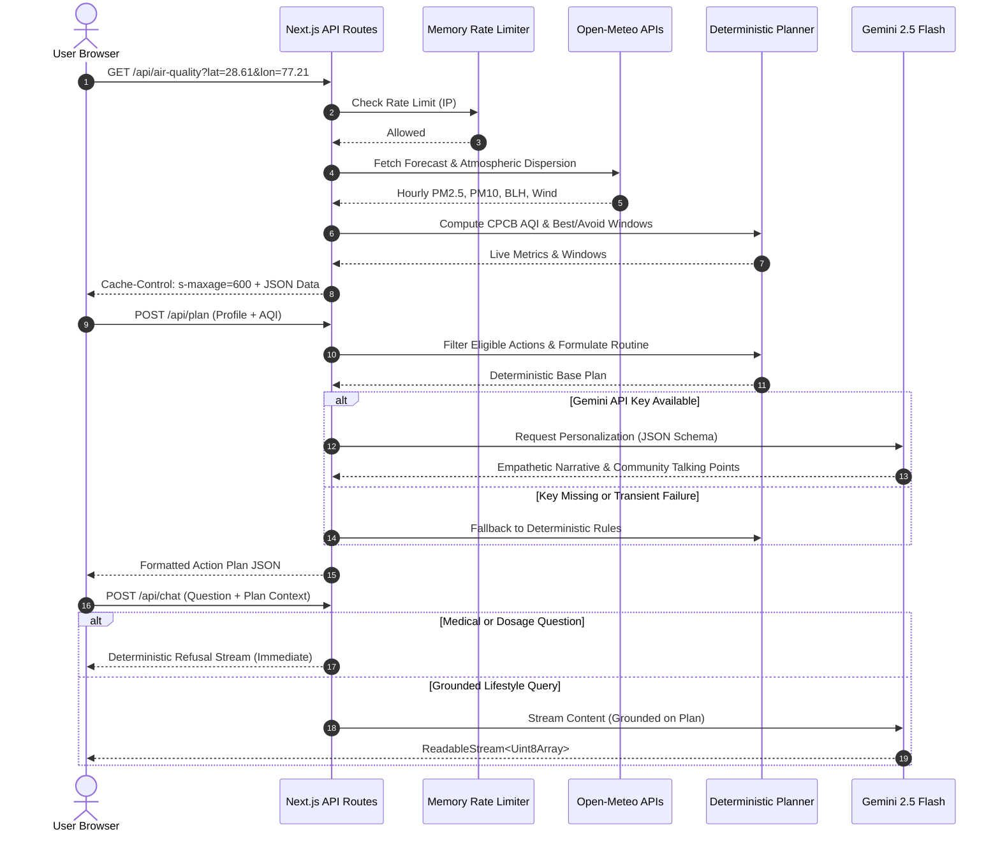

# SaafSaans Technical Architecture & System Design

## 1. System Overview & Philosophy

**SaafSaans (साफ़ साँस)** is an open-source, production-grade winter smog assistant designed for high-density metropolitan areas (such as the Indo-Gangetic Plain, Delhi-NCR, Lucknow, and Kolkata).

The architecture is built on a strict **Deterministic Foundation with Generative AI Personalization Layer**:

- **Deterministic Domain Engine:** All calculations—AQI sub-indices, CPCB breakpoints, WHO multiples, 48-hour timeline windowing, demographic eligibility filtering, and non-double-counting exposure impact math—are computed with pure, side-effect-free, 100% test-covered TypeScript.
- **Generative AI Personalization (Gemini 2.5 Flash):** An LLM is invoked strictly to formulate empathetic lifestyle narratives, translate localized rationale into Hindi/Bengali, and answer user follow-up questions. The LLM is **never** permitted to calculate numbers, alter health tiers, or dispense medical advice.
- **Atmosphere Journal UI:** A lightweight, high-contrast, editorial design system built with Tailwind CSS v4, zero external chart libraries (custom inline SVG area charts), accessible Radix UI primitives, and full keyboard/screen-reader compliance.

---

## 2. Component Breakdown

### 2.1 Next.js 16 App Router & Edge-Ready Server Layer

- **Location:** `src/app/`
- **Routing:** App Router with React Server Components (RSC) and Turbopack dev bundling.
- **Endpoints:**
  - `GET /api/health`: Uptime, deployment status, and operating mode (`ai` vs `rule-based`).
  - `GET /api/geocode?q=...`: Forward geocoding with input sanitization and rate limiting.
  - `GET /api/air-quality?lat=...&lon=...`: Aggregated 48-hour forecast and boundary-layer meteorological metrics.
  - `POST /api/plan`: Demographic profile evaluation, deterministic action selection, and optional Gemini narrative enrichment.
  - `POST /api/chat`: Grounded streaming Q&A route returning a `ReadableStream<Uint8Array>` with deterministic medical guardrails.

### 2.2 Deterministic Domain Layer

- **Location:** `src/domain/`
- **Zero External Dependencies:** Built with pure TypeScript, using branded types (`AqiIndex`, `Pm25UgM3`, `KgCo2e`, `Percentage`) to prevent unit mismatches at compile time.
- **Key Modules:**
  - `src/domain/aqi/`: Indian National Air Quality Index (CPCB) piecewise linear subindex interpolation for $PM_{2.5}$, $PM_{10}$, and $NO_2$.
  - `src/domain/exposure/`: Indoor/outdoor physical infiltration attenuation models.
  - `src/domain/impact/`: Multiplicative exposure reduction ($R = 1 - \prod (1 - r_i)$) with an 85% physical ceiling, and additive $CO_2e$ savings.
  - `src/domain/catalog/`: Vetted catalog of ~30 interventions with peer-reviewed evidence citations.
  - `src/domain/profile/`: Demographic schemas and 1-click household presets.
  - `src/domain/planner/`: Priority ranking, time-blocking, and 48-hour optimal/avoid windowing.

### 2.3 Generative AI & Safety Architecture

- **Location:** `src/server/ai/`, `src/domain/ai/`
- **Model:** Google Gemini 2.5 Flash via `@google/genai` SDK.
- **Timeout & Retry:** Strict 8-second execution timeout; single exponential backoff retry on transient 429/503 errors.
- **Structured Schema Enforcement:** The model is instructed with JSON schema validation via Zod (`StructuredAiResponse`). Any response failing schema validation safely degrades to deterministic rule-based advice.
- **Delimiter Isolation:** Prompts use explicit `<<<INSTRUCTIONS>>>`, `<<<DATA>>>`, and `<<<USER_QUESTION>>>` delimiters to isolate untrusted input and prevent prompt injection attacks.
- **Deterministic Medical Guardrail:** A hardcoded regex engine intercepts and immediately refuses questions soliciting drug prescriptions, clinical dosages, or medical diagnoses without sending tokens to the LLM.

### 2.4 Atmosphere Journal UI System

- **Location:** `src/features/`, `src/components/`
- **Design Metaphor:** An editorial, broadsheet newspaper and atmospheric dispatch aesthetic ("Atmosphere Journal") using off-white textured paper backgrounds (`#FBF9F5`), deep forest green (`#1A5341`), mint teal (`#2DD4BF`), and crisp serif headlines (`font-serif`).
- **Sections:**
  - `01 Air now`: Skyline haze opacity interpolation (0.10 to 0.85), ambient dial, and plain-language health verdict.
  - `02 Next 48 hours`: Custom inline SVG area chart with draggable and keyboard-scrubbable slider, highlighted best/avoid windows, and accessible table toggle.
  - `03 Your household`: 1-click persona presets ("Family with kids", "Hostel student") and custom demographic adjustments.
  - `04 Your plan`: 4-tab actionable planner (Routine, Home air, Swaps, Community) with multi-language selector (English, Hindi, Bengali) and embedded Grounded Follow-up Q&A drawer.
  - `05 Your impact`: Interactive What-If checklist with real-time animated exposure meter and transparent mathematical model drawer.
  - `Printable Family Air Plan`: Emergency one-page high-contrast printable sheet designed for refrigerator display.

---

## 3. Data Flow Diagram

---

## 4. Security & Compliance Architecture

1. **SSRF & Host Allowlisting:** Outbound HTTP fetches from the server are restricted strictly to allowlisted hosts (`api.open-meteo.com`, `geocoding-api.open-meteo.com`, `generativelanguage.googleapis.com`).
2. **Strict HTTP Security Headers:**
   - `Content-Security-Policy`: Disallows unauthorized script and frame injection.
   - `X-Content-Type-Options: nosniff`
   - `X-Frame-Options: DENY`
   - `Strict-Transport-Security`: `max-age=63072000; includeSubDomains; preload`
   - `Permissions-Policy`: Blocks camera and microphone access.
3. **Sliding Window Rate Limiting:**
   - Geocode: 30 requests / min / IP
   - Air Quality: 30 requests / min / IP
   - Plan Generation: 10 requests / min / IP
   - Chat Follow-up: 20 requests / min / IP
4. **Accessibility (WCAG 2.1 AA):**
   - Verified with automated `axe-core` CI tests with **zero** violations across all components and themes.
   - Screen-reader announcements via `aria-live="polite"` regions.
   - Full keyboard operability: Tab navigation, Left/Right timeline scrubber control, 'T' theme toggle, and '?' shortcut palette.
